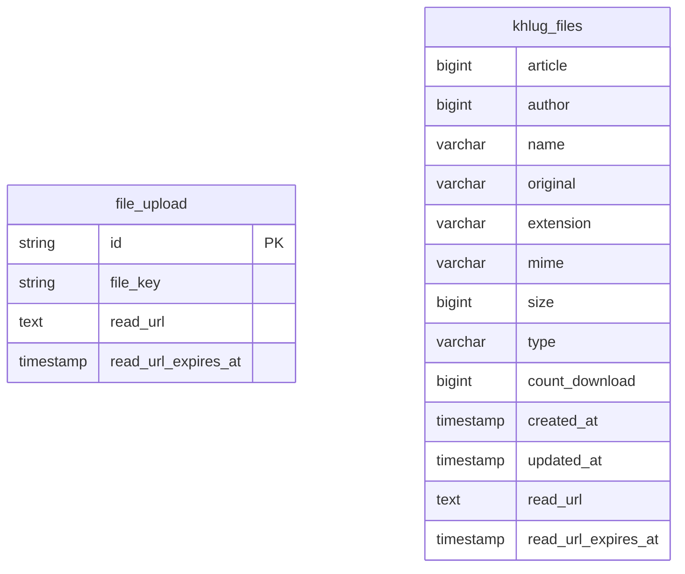

# 파일 영구 주소와 레거시 테이블 유지

## 작업 개요

sight-spring-backend에서 [이전 계획](../../plans/file-migration.md)과 [파일 조회](../../plans/group/group-file-get.md)를 구현한다. 기존 파일 경로와 신규 영구 주소가 Laravel 없이 파일을 제공하는 것이 완료 기준이다. 프런트는 [그룹 공통 명세](../../plans/group/global.md)의 파일 계약을 따르며, 서버의 파일 API 제공 후 영구 주소를 사용하는 프런트를 배포한다.

## 비즈니스 동작

사이트 전체 파일을 담은 레거시 `khlug_files`를 기존 데이터와 컬럼을 유지해 Spring에서 사용하며 임시 읽기 URL 캐시 컬럼만 추가한다. 신규 업로드 테이블과 분리해 유지하며 객체 키도 유지한다. 그룹 파일의 영구 주소는 그룹 VIEWER를 검사한 뒤 Presigned GET URL로 리다이렉션한다. 더 강한 권한이 필요한 파일은 이 경로로 제공하지 않고 각 기능 API에서 처리한다. 활동보고 파일은 기존 API가 임시 읽기 주소를 직접 반환한다. 파일 캐시가 유효해도 권한은 매번 검사한다. 신규 업로드의 PUT URL 발급·연결·완료 흐름을 유지한다. 서버는 본문 문자열을 그대로 저장·반환하며 파일 주소를 파싱·검사·치환하지 않는다. 영구 주소의 본문 반영은 프런트가 담당한다. 파일 배열은 사용자가 첨부 목록과 본문의 일치를 확인할 수 있도록 유지한다. 기존 HTML은 유지한다.

## HTTP API 계약

### GET /groups/{groupId}/files/{fileId}

- `groupId`: 숫자(Long), 파일의 소속 그룹.
- `fileId`: 문자열, 업로드 기록 아이디.
- 응답 헤더 `Location`: 권한 검사 후 발급하거나 캐시한 Presigned GET URL.
- 응답 헤더 `Cache-Control`: `private, no-store`.

성공은 본문 없는 302다. 그룹 VIEWER를 검사하며 작성자·임시저장 소유자 등 추가 권한은 검사하지 않는다. 파일의 실제 그룹 소속과 제공 대상 여부를 검사해 활동보고 등 별도 권한으로 보호되는 파일은 404로 제외한다. 인증 없음 401, 그룹 열람 권한 없음 403, 미존재·다른 그룹·삭제·미완료 404, 형식 오류 400, 스토리지 실패 502다. 읽기는 그룹 상태를 변경하지 않는다.

### GET /file/{filename}

- `filename`: 레거시 저장명. 기존 `khlug_files.name`으로 조회한다.

[레거시 파일 API](../../plans/legacy-file-get.md)에 따라 원본 리소스 권한을 검사하고 302로 제공한다. 신규 파일은 이 경로에서 404다. 기존 공개 범위를 유지하며 미확인 소속은 공개하지 않는다.

### GET /image/{filename}

- `filename`: 레거시 객체 키.

[레거시 이미지 API](../../plans/legacy-image-get.md)를 적용한다. 상태·캐싱 계약은 파일 경로와 같다.

기록 작성·수정·임시저장 응답의 `uploads.url`은 영구 주소를 반환한다. `files.url`과 `coverImageUrl`도 영구 주소를 사용한다. 활동보고의 `reportFileUrl`은 기존처럼 임시 읽기 주소를 직접 반환하며 제출·수정 응답도 유지한다. 업로드 아이디가 없던 블록은 응답 반영 후 후속 저장하며 서버가 본문을 치환하지 않는다. 정확한 요청·응답은 개별 API 문서를 따른다.

## 데이터베이스 계약

- 신규 `file_upload`에 `read_url TEXT NULL`·`read_url_expires_at TIMESTAMP(6) NULL`을 추가한다. 기본값은 null이며 시각은 UTC다.
- `khlug_files`에는 `read_url TEXT NULL`·`read_url_expires_at TIMESTAMP(6) NULL`만 추가한다. 기본값은 null이며 시각은 UTC다. 캐시 갱신 시 기존 `updated_at`은 유지한다. 전체 행과 기존 컬럼·제약을 보존한다. 신규 ID·레거시 JSON을 추가하거나 신규 파일 테이블에 병합하지 않는다. `article`·`name` 등 기존 참조를 유지한다.
- 레거시 파일을 위한 신규 그룹 소속·기록 연결 행을 만들지 않는다. 신규 파일 연결과 상태·검증 계약은 유지한다.
- 기존 테이블이 다른 DB에 있으면 구조와 전체 데이터를 가져오고 변경분을 반영한다. 이미 같은 DB이면 그대로 사용한다. 운영자는 원본·대상 건수와 메타데이터·객체 키를 대조한다.
- 레거시 파일은 신규 업로드 확인·미사용·참조 부재 청소에서 제외한다. 테이블 분리·통합은 사이트 전체 Spring 전환 이후 별도 작업이다.

## 외부 시스템 계약

기존 R2 버킷과 객체를 사용한다. 신규 PUT 계약은 유지하며 파일 조회에서 Presigned GET URL을 생성한다. 캐시는 파일별로 사용하고 만료까지 1분 이하이면 7일 유효 URL을 재발급한다. 스토리지 실패는 성공 URL로 캐시하지 않는다. 파일 응답 헤더는 [공통 파일 제공 기준](../../plans/group/global.md#파일-제공-헤더)을 따른다. Caddy의 기존 도메인 파일 경로는 Spring으로 전달한다.

## 보안 및 개인정보

그룹 파일 경로는 그룹 열람 권한과 실제 파일 소속·제공 범위를 검사한다. 더 강한 권한의 파일은 각 API에서 별도로 제공하며 그룹 경로를 통한 우회를 차단한다. 레거시의 미확인 소속·권한을 추정해 공개하지 않는다. Presigned URL과 서명 쿼리는 로그에 남기지 않는다. 이미 발급된 URL은 만료까지 사용할 수 있으므로 즉시 권한 철회로 간주하지 않는다. 리다이렉션 응답은 캐싱하지 않는다.

## 비가역적 부작용 및 운영 영향

기존 파일 테이블의 구조·데이터·R2 객체를 보존한다. 별도 DB로 가져오는 경우의 변경분 반영과 원본·대상 대조는 운영자가 수행한다. 그룹 외 파일도 있으므로 일부 행만 선별하거나 신규 청소로 삭제하지 않는다.

## 호환성 및 배포

기존 테이블의 Spring 접근과 신규 URL 캐시 컬럼을 준비한 뒤 파일 API, Caddy 라우팅, 프런트 전환을 진행한다. Laravel 종료는 사이트 전체 Spring 전환 완료 후 판단한다. 구체 순서와 재실행·되돌리기는 이전 계획을 따른다. 다른 Spring 서비스의 파일 주소도 소속 리소스별 영구 경로로 제공하고 개별 API 계약에 반영한다.

## 검증

사용자가 직접 동작을 확인한다. 에이전트는 요청 없이 테스트·브라우저 조작을 수행하지 않는다.

- 레거시 테이블의 전체 행·컬럼·객체 키가 보존되고 신규 파일 테이블과 구분되는지 확인한다. 그룹 외 파일도 기존 경로로 제공되는지 확인한다.
- 레거시 캐시가 비어 있으면 발급하고 유효하면 재사용하며 만료 임박 시 재발급하는지 확인한다. URL·만료 시각만 갱신하고 기존 `updated_at`과 메타데이터는 유지한다.
- 신규·레거시 경로의 302, 접근 허용·거부, 미완료·삭제·다른 그룹, URL 캐시 재사용·재발급을 확인한다.
- 기존 도메인 링크와 미디어·다운로드·Range가 Laravel 종료 상태에서도 동작하는지 확인한다.
- 업로드 응답의 `id`·`fileId`·영구 주소 `url`·Presigned PUT `uploadUrl`과 저장된 파일 연결을 확인한다.
- 기록·임시저장·커버 조회는 영구 주소를 반환하고 활동보고 조회는 기존 임시 주소를 반환하는지 확인한다. 별도 권한의 파일은 그룹 파일 경로에서 404이며 레거시가 신규 청소로 삭제되지 않는지 확인한다.

## 비목표

레거시 파일 테이블 병합·분리, 그룹 파일 선별 이전, R2 객체 이동, 레거시 HTML 변환, 권한 확대, 사이트 전체 마이그레이션과 Laravel 종료의 직접 실행.
