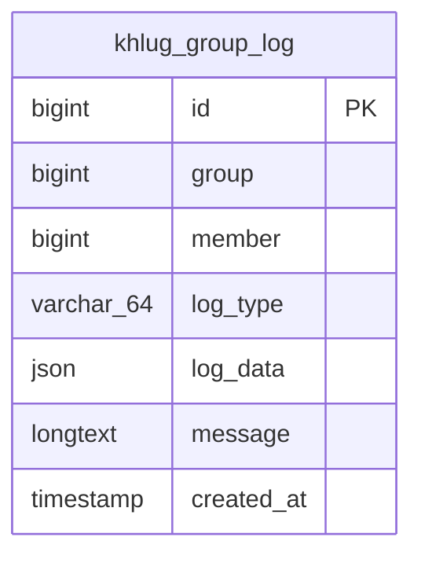

# 그룹 활동 로그의 로그타입과 로그데이터

## 작업 개요

관련 저장소는 sight-spring-backend다. 그룹 활동 로그를 로그타입(logType)과 로그데이터(logData)로 나눈다. 신규 로그의 완성된 문장이나 Markdown을 저장하는 대신 이벤트별 JSON 데이터를 저장·제공한다. 연동 작업은 [Frontend Task](group-log-format-frontend.md)를 따른다.

기존 로그는 LEGACY로 분류하고 HTML 원문을 보존한다. 완료 기준은 DB와 조회 응답에 로그타입·로그데이터가 제공되고 현재 구현된 네 가지 로깅 동작이 이벤트별 JSON으로 저장되는 것이다.

## 비즈니스 동작

- 로그타입은 LEGACY와 아래 50개 이벤트 enum 값이다. 같은 카드 이동은 요청 경로가 달라도 CARD_MOVED를 사용한다.
- 신규 로그데이터는 해당 로그타입에 대응하는 JSON 객체다. 완성 문장·Markdown·HTML이나 직렬화한 JSON 문자열을 객체 대신 넣지 않는다. 부가 값이 없는 이벤트도 빈 객체를 저장한다.
- 제목·이름·설명·레이블 등 당시 표시 정보를 로그데이터에 스냅샷으로 저장한다. 이후 대상의 이름이 바뀌거나 삭제되어도 발생 당시 내용을 조회할 수 있다.
- 카드·리스트·기록의 식별자는 데이터에 별도로 보관한다. 클릭용 HTML·Markdown 링크를 저장하지 않는다.
- 현재 구현된 그룹장 위임·그룹 참여·회원 내보내기·그룹 탈퇴는 각각 GROUP_LEADER_DELEGATED·GROUP_MEMBER_JOINED·GROUP_MEMBER_KICKED·GROUP_MEMBER_LEFT와 대응 데이터로 저장한다.
- 신규 스프링 로깅에는 로그타입과 로그데이터를 모두 필수로 받으며 타입별 필수 필드와 값 타입을 검사한다. 신규 이벤트를 LEGACY로 저장하지 않는다.
- enum 정의만으로 아직 없는 비즈니스 기능을 구현하지 않는다. 나머지 동작을 구현할 때 해당 타입과 데이터를 사용한다.
- 카드 이어받기 기능은 이번 구현 범위 밖이지만, 이어받기 설정·해제의 로그타입과 로그데이터 정의는 유지한다.
- 기존 이벤트 발생 조건·포인트·알림·재시도·중복 처리 정책은 바꾸지 않는다. 조회 시 로그를 새로 만들지 않는다.
- 레거시에서 별도 로그가 없던 자동 중단·자동 재진행·같은 리스트 내 순서 변경·개인 보관 등에 임의로 새 로그를 추가하지 않는다.

### LEGACY

기존 모든 로그와 구버전·레거시가 새 컬럼 없이 저장한 로그를 포함한다. 기존 message 컬럼의 HTML을 수정하지 않으며, 조회 응답의 logData는 `{ "html": "기존 HTML 원문" }` 객체로 제공한다. 기존 스프링의 일반 텍스트 로그도 LEGACY로 분류하고 내용을 수정하지 않는다.

### 로그데이터 필드 규칙

- 아래 표의 필드는 모두 필수이며 null을 허용하지 않는다. 부가 값이 없는 이벤트는 빈 객체다.
- 필드에 별도 타입 표기가 없으면 문자열이다. groupId 및 sourceGroupId와 회원 식별자(targetUserId·fromUserId·toUserId·assigneeUserId)는 스프링 도메인에 따라 Long 숫자다. recordId는 [그룹 공통 아이디 타입](../../plans/group/global.md#아이디-타입)에 따라 Long 숫자다.
- 아직 도메인이 없는 리스트·카드 식별자는 문자열이다. 도메인 추가 시 그룹 공통 ID 기준을 함께 적용한다.
- 이름·제목·소속은 동작 당시 원문 텍스트다. JSON 이스케이프 외에 HTML·Markdown 이스케이프를 적용하지 않는다.
- changedFields는 실제 변경한 항목의 표시명 배열이다. 레거시 기준 제목·목적·분야·기술·공개 범위·저장소 중 변경한 항목을 담는다.
- category는 GroupCategory의 API enum 값이다. label은 카드 레이블 API의 값이며 색상을 문자열로 보존한다.
- description은 당시 설명 원문 문자열이며 렌더링에서는 일반 텍스트로 취급한다. contentText는 당시 기록 본문에서 추출한 텍스트이며 문단·줄바꿈을 보존한다. 실행 가능한 원문 HTML을 신규 로그데이터에 넣지 않는다.
- termYear는 연도 정수, termSemester는 당시 학기 표시명 문자열이다. 구분자의 위치에 의존하는 합성 문자열로 저장하지 않는다.

### 그룹

| logType | 기록되는 동작 | logData 필드 | 레거시 근거 |
| :-- | :-- | :-- | :-- |
| `GROUP_CREATED` | 그룹 생성 | groupTitle | [코드](../../../../opened-sight-legacy/GroupController.php:392) |
| `GROUP_INFO_UPDATED` | 제목·목적·분야·기술·공개 범위·저장소 수정 | changedFields: string[] | [코드](../../../../opened-sight-legacy/GroupController.php:487) |
| `GROUP_JOIN_ENABLED` | 참여 신청 허용 | {} | [코드](../../../../opened-sight-legacy/GroupController.php:501) |
| `GROUP_JOIN_DISABLED` | 참여 신청 차단 | {} | [코드](../../../../opened-sight-legacy/GroupController.php:501) |
| `GROUP_CATEGORY_UPDATED` | 그룹 분류 변경 | category | [코드](../../../../opened-sight-legacy/GroupController.php:523) |
| `GROUP_DEPARTMENTS_SET` | 특수 조직 설정 | departmentNames: string[] | [코드](../../../../opened-sight-legacy/GroupController.php:554) |
| `GROUP_DEPARTMENTS_CLEARED` | 특수 조직 해제 | {} | [코드](../../../../opened-sight-legacy/GroupController.php:559) |
| `GROUP_PROGRESS` | 진행 상태로 변경 | {} | [코드](../../../../opened-sight-legacy/GroupController.php:604) |
| `GROUP_ENDED_SUCCESS` | 성공 종료 | {} | [코드](../../../../opened-sight-legacy/GroupController.php:614) |
| `GROUP_ENDED_FAIL` | 실패 종료 | {} | [코드](../../../../opened-sight-legacy/GroupController.php:621) |
| `GROUP_STOPPED` | 수동 중단 | {} | [코드](../../../../opened-sight-legacy/GroupController.php:628) |
| `GROUP_PORTFOLIO_UNPUBLISHED` | 그룹 포트폴리오 취소 | {} | [코드](../../../../opened-sight-legacy/GroupController.php:656) |
| `GROUP_PORTFOLIO_PUBLISHED` | 그룹 포트폴리오 발행 | {} | [코드](../../../../opened-sight-legacy/GroupController.php:664) |
| `GROUP_MEMBER_JOINED` | 그룹 참여 | {} | [코드](../../../../opened-sight-legacy/GroupController.php:718) |
| `GROUP_MEMBER_LEFT` | 그룹 탈퇴 | {} | [코드](../../../../opened-sight-legacy/GroupController.php:740) |
| `GROUP_MEMBER_KICKED` | 회원 내보내기 | targetUserId, targetUserName, targetUserCollege | [코드](../../../../opened-sight-legacy/GroupController.php:764) |
| `GROUP_LEADER_DELEGATED` | 그룹장 위임 | fromUserId, fromUserName, fromUserCollege, toUserId, toUserName, toUserCollege | [코드](../../../../opened-sight-legacy/GroupController.php:784) |

### 리스트

| logType | 기록되는 동작 | logData 필드 | 레거시 근거 |
| :-- | :-- | :-- | :-- |
| `LIST_CREATED` | 리스트 생성 | listId, listTitle | [코드](../../../../opened-sight-legacy/GroupController.php:848) |
| `LIST_TITLE_UPDATED` | 리스트 이름 변경 | listId, oldTitle, newTitle | [코드](../../../../opened-sight-legacy/GroupController.php:865) |
| `LIST_DESCRIPTION_UPDATED` | 리스트 설명 변경 | listId, listTitle, description | [코드](../../../../opened-sight-legacy/GroupController.php:868) |
| `LIST_DELETED` | 리스트 삭제 | listId, listTitle | [코드](../../../../opened-sight-legacy/GroupController.php:895) |

### 카드

| logType | 기록되는 동작 | logData 필드 | 레거시 근거 |
| :-- | :-- | :-- | :-- |
| `CARD_CREATED` | 카드 생성 | cardId, cardTitle | [코드](../../../../opened-sight-legacy/GroupController.php:959) |
| `CARD_TITLE_UPDATED` | 카드 이름 변경 | cardId, oldTitle, newTitle | [코드](../../../../opened-sight-legacy/GroupController.php:1000) |
| `CARD_DESCRIPTION_ADDED` | 카드 설명 최초 추가 | cardId, cardTitle, description | [코드](../../../../opened-sight-legacy/GroupController.php:1002) |
| `CARD_DESCRIPTION_UPDATED` | 카드 설명 수정 | cardId, cardTitle, description | [코드](../../../../opened-sight-legacy/GroupController.php:1004) |
| `CARD_MOVED` | 다른 리스트로 이동. 드래그와 별도 이동 요청에 같은 타입 사용 | cardId, cardTitle, fromListId, fromListTitle, toListId, toListTitle | [코드](../../../../opened-sight-legacy/GroupController.php:1044) |
| `CARD_DELETED` | 카드 소프트 삭제 | cardId, cardTitle | [코드](../../../../opened-sight-legacy/GroupController.php:1141) |
| `CARD_DISABLED` | 카드 비활성화 | cardId, cardTitle | [코드](../../../../opened-sight-legacy/GroupController.php:1174) |
| `CARD_ENABLED` | 카드 재활성화 | cardId, cardTitle | [코드](../../../../opened-sight-legacy/GroupController.php:1207) |
| `CARD_RESTORED` | 카드 복구 | cardId, cardTitle, listId, listTitle | [코드](../../../../opened-sight-legacy/GroupController.php:1243) |
| `CARD_ASSIGNEE_CLEARED` | 담당자 해제 | cardId, cardTitle | [코드](../../../../opened-sight-legacy/GroupController.php:1275) |
| `CARD_ASSIGNEE_SET` | 담당자 지정·변경 | cardId, cardTitle, assigneeUserId, assigneeUserName, assigneeUserCollege | [코드](../../../../opened-sight-legacy/GroupController.php:1294) |
| `CARD_INHERITANCE_CLEARED` | 이어받기 해제 | cardId, cardTitle | [코드](../../../../opened-sight-legacy/GroupController.php:1351) |
| `CARD_INHERITANCE_SET` | 이어받기 설정 | cardId, cardTitle, sourceGroupId, sourceGroupTitle, sourceCardId, sourceCardTitle | [코드](../../../../opened-sight-legacy/GroupController.php:1376) |
| `CARD_LABEL_REMOVED` | 레이블 제거 | cardId, cardTitle, label | [코드](../../../../opened-sight-legacy/GroupController.php:1404) |
| `CARD_LABEL_ADDED` | 레이블 추가 | cardId, cardTitle, label | [코드](../../../../opened-sight-legacy/GroupController.php:1406) |
| `CARD_PORTFOLIO_REMOVED` | 카드 포트폴리오 제외 | cardId, cardTitle | [코드](../../../../opened-sight-legacy/GroupController.php:1518) |
| `CARD_PORTFOLIO_ADDED` | 카드 포트폴리오 포함 | cardId, cardTitle | [코드](../../../../opened-sight-legacy/GroupController.php:1520) |
| `CARD_COVER_ADDED` | 커버 이미지 업로드·교체 | cardId, cardTitle | [코드](../../../../opened-sight-legacy/GroupController.php:1830) |
| `CARD_COVER_REMOVED` | 커버 이미지 제거 | cardId, cardTitle | [코드](../../../../opened-sight-legacy/GroupController.php:1862) |

### 기록

| logType | 기록되는 동작 | logData 필드 | 레거시 근거 |
| :-- | :-- | :-- | :-- |
| `RECORD_UPDATED` | 기록 본문 수정 | recordId, cardId, cardTitle, contentText | [코드](../../../../opened-sight-legacy/GroupController.php:1615) |
| `RECORD_CREATED` | 기록 작성. Slack 경유 작성도 같은 타입 | recordId, cardId, cardTitle, contentText | [코드](../../../../opened-sight-legacy/GroupController.php:1672) |
| `RECORD_DELETED` | 기록 소프트 삭제 | recordId, cardId, cardTitle | [코드](../../../../opened-sight-legacy/GroupController.php:1714) |
| `RECORD_RESTORED` | 기록 복구 | recordId, cardId, cardTitle | [코드](../../../../opened-sight-legacy/GroupController.php:1747) |
| `RECORD_PORTFOLIO_REMOVED` | 기록 포트폴리오 제외 | recordId, cardId, cardTitle | [코드](../../../../opened-sight-legacy/GroupController.php:1784) |
| `RECORD_PORTFOLIO_ADDED` | 기록 포트폴리오 포함 | recordId, cardId, cardTitle | [코드](../../../../opened-sight-legacy/GroupController.php:1787) |
| `RECORD_MOVED` | 다른 카드로 기록 이동 | recordId, fromCardId, fromCardTitle, toCardId, toCardTitle | [코드](../../../../opened-sight-legacy/GroupController.php:1994) |

### 세미나

| logType | 기록되는 동작 | logData 필드 | 레거시 근거 |
| :-- | :-- | :-- | :-- |
| `SEMINAR_PRESENTATION_CANCELLED` | 세미나 발표 신청 취소 | termYear: 정수, termSemester | [코드](../../../../opened-sight-legacy/GroupController.php:2110) |
| `SEMINAR_PRESENTATION_REGISTERED` | 세미나 발표 신청 | termYear: 정수, termSemester | [코드](../../../../opened-sight-legacy/GroupController.php:2122) |
| `SEMINAR_SESSION_REMOVED` | 운영진의 세미나 세션 제거 | termYear: 정수, termSemester | [코드](../../../../opened-sight-legacy/GroupController.php:2320) |

## HTTP API 계약

### GET /groups/:groupId/logs

기존 활동 로그 조회의 본문 표현을 logType과 logData로 교체한다. 로그인·그룹원 권한, 기존 401·403·404 처리 및 200 성공은 유지한다.

- 경로 groupId: Group.id와 같은 Long.
- 쿼리 offset: 기존의 0 이상 정수, 기본 0.
- 쿼리 limit: 기존의 1~100 정수, 기본 100.
- 요청 바디: 없음.
- 응답 count: 기존 전체 개수.
- 응답 logs[].id: 기존 Long.
- 응답 logs[].memberId: 기존 Long. 시스템은 기존대로 0.
- 응답 logs[].logType: 필수 문자열 enum. LEGACY 또는 위 이벤트 값이며 null이 아니다.
- 응답 logs[].logData: 필수 JSON 객체. logType별 스키마를 따르며 JSON 문자열로 이중 인코딩하지 않는다.
- 응답 logs[].createdAt: 기존 시각 필드. 이 Task는 시각 변환 정책을 변경하지 않는다.
- 기존 logs[].message는 최종 응답에서 제거한다. type·data라는 축약 필드도 사용하지 않는다.

```json
{
  "count": 2,
  "logs": [
    {
      "id": 10001,
      "memberId": 7,
      "logType": "CARD_MOVED",
      "logData": {
        "cardId": "2001",
        "cardTitle": "API 설계",
        "fromListId": "1001",
        "fromListTitle": "할 일",
        "toListId": "1002",
        "toListTitle": "진행 중"
      },
      "createdAt": "2026-10-26T10:00:00"
    },
    {
      "id": 10000,
      "memberId": 7,
      "logType": "LEGACY",
      "logData": {
        "html": "<a href=\"#2001\">API 설계</a> 카드가 추가되었습니다."
      },
      "createdAt": "2026-10-25T10:00:00"
    }
  ]
}
```

이름·제목 스냅샷은 로그 내용이며 현재 대상 리소스의 정보로 덮어쓰지 않는다. 대상 식별자는 참조를 위한 값이며 접근 권한을 부여하지 않는다. actor 객체, totalCount·skip 페이지네이션, UTC 직렬화 등 별도 설계 변경은 이 Task에서 수행하지 않는다.

## 데이터베이스 계약



- 기존 khlug_group_log에 log_type VARCHAR(64) NOT NULL DEFAULT 'LEGACY'와 log_data JSON NULL을 추가한다. 도메인 속성 이름은 logType과 logData다.
- log_type은 enum 이름으로 저장한다. ordinal이나 MySQL ENUM은 사용하지 않는다.
- 신규 이벤트의 log_data에는 해당 스키마의 JSON 객체를 저장한다. JSON 문자열을 다시 JSON 값으로 감싸지 않는다. 신규 이벤트에서는 log_data가 null이면 안 된다.
- 기존 모든 행은 log_type=LEGACY, log_data=NULL로 둔다. 기존 message·id·group·member·created_at은 수정하지 않는다.
- LEGACY의 원본은 기존 message LONGTEXT다. API에서 이를 logData.html로 감싸 반환하며 JSON 컬럼으로 HTML 전체를 복사하는 backfill은 하지 않는다.
- 새 이벤트는 log_data를 사용하고 기존 NOT NULL message 컬럼에는 빈 문자열을 저장한다. 이 빈 문자열을 신규 로그의 내용으로 사용하지 않는다.
- 기존 PK·유니크·인덱스·그룹/회원 참조·삭제 정책은 유지한다. 새 FK나 인덱스는 추가하지 않는다.
- 구버전·레거시의 컬럼 없는 INSERT는 기본값 LEGACY와 NULL log_data로 호환한다. 신규 스프링은 필수 데이터 검증을 거친다.
- 컬럼 추가의 잠금·재구성 여부는 운영 DB와 데이터 크기를 기준으로 배포 전에 확인한다. 운영 마이그레이션은 이 문서 작성 작업에서 실행하지 않는다.
- 신규 JSON 로그가 저장된 이후에는 컬럼을 삭제하거나 message만 읽는 구버전으로 단순 복귀하지 않는다.

## 외부 시스템 계약

GitHub·Discord 호출과 인증·호출량 제한은 변경하지 않는다. 레거시 DB 작성자의 기존 message INSERT를 유지하고 새 컬럼의 기본값으로 공존한다. 레거시 HTML 로깅 함수를 이 Task에서 수정하지 않는다.

## 보안 및 개인정보

그룹원 권한과 특수 그룹의 기존 접근 범위를 확장하지 않는다. 신규 데이터의 이름·제목·설명은 텍스트이며 실행할 HTML이나 URL 코드를 생성하지 않는다. LEGACY 원문 보존과 표시 계층의 기존 HTML 정제 원칙을 유지한다.

대상 이름과 소속은 로그 발생 당시 스냅샷으로 보존한다. 기존 메시지가 포함하던 정보 범위를 넘는 연락처·이메일·원본 파일 데이터는 추가하지 않는다. 행위자 이름을 별도 컬럼으로 추가하지 않고 기존 회원 ID와 보존 기간을 유지한다.

## 비가역적 부작용 및 운영 영향

기존 HTML을 일괄 변환·삭제하지 않는다. 신규 데이터는 스키마에 맞는 JSON으로 저장하며 타입이 없는 과거 행의 이벤트를 역추정하지 않는다. 변경 자체로 알림·포인트·외부 호출을 발생시키지 않는다. 기존 데이터 건수와 HTML 원문 보존 여부를 배포 전후 비교한다.

## 호환성 및 배포

1. DB에 log_type과 log_data를 추가한다. 기존 작성자는 계속 LEGACY로 저장한다.
2. 로그데이터를 반환하는 API와 이를 읽을 소비자를 조정 배포한다. 전환 기간에는 기존 message 응답을 유지하며 logType·logData를 병행 제공한다.
3. 소비자가 새 계약을 사용하는 것을 확인한 뒤 신규 JSON 로그 저장을 활성화한다.
4. 최종 응답에서 message를 제거한다. DB의 message 컬럼은 LEGACY 원본과 레거시 작성자 호환을 위해 유지한다.

신규 JSON 로그 생성 후에는 logType·logData를 해석할 수 있는 버전으로만 rollback한다. 조회 응답의 다른 필드 변경을 묶어서 배포하지 않는다.

## 검증

사용자가 구현 후 다음 결과를 확인한다. 에이전트는 명시적 요청 없이 테스트·브라우저 조작을 수행하지 않는다.

- 기존 로그는 logType=LEGACY이며 logData.html이 기존 message와 일치한다. 원본·건수·시각·아이디는 바뀌지 않는다.
- 구버전 작성자의 컬럼 없는 INSERT가 LEGACY로 저장된다.
- 현재 네 로깅 동작은 해당 logType과 필수 필드가 있는 JSON 객체로 저장·조회된다.
- 누락된 타입·필수 데이터, 잘못된 필드 타입, null·문자열 형태의 신규 logData는 저장하지 않는다.
- 이름 변경·대상 삭제 후에도 당시 이름과 레이블 색상 데이터가 보존된다.
- 특수문자·HTML처럼 보이는 이름이 텍스트로 보존되고 임의의 링크 문법이나 코드를 만들지 않는다.
- 권한·offset·limit·count·정렬·오류 처리와 기존 로그 발생 횟수·포인트·알림은 유지된다.
- 최종 API에 message·type·data는 없고 logType·logData가 제공된다.

## 비목표

아직 없는 그룹·카드·기록·세미나 API의 신규 구현, 기존 HTML의 이벤트 역추정·JSON 변환, 행위자 이름 컬럼 추가, 페이지네이션·시각·회원 응답 구조 변경, 프런트엔드 창 상태 구현.
